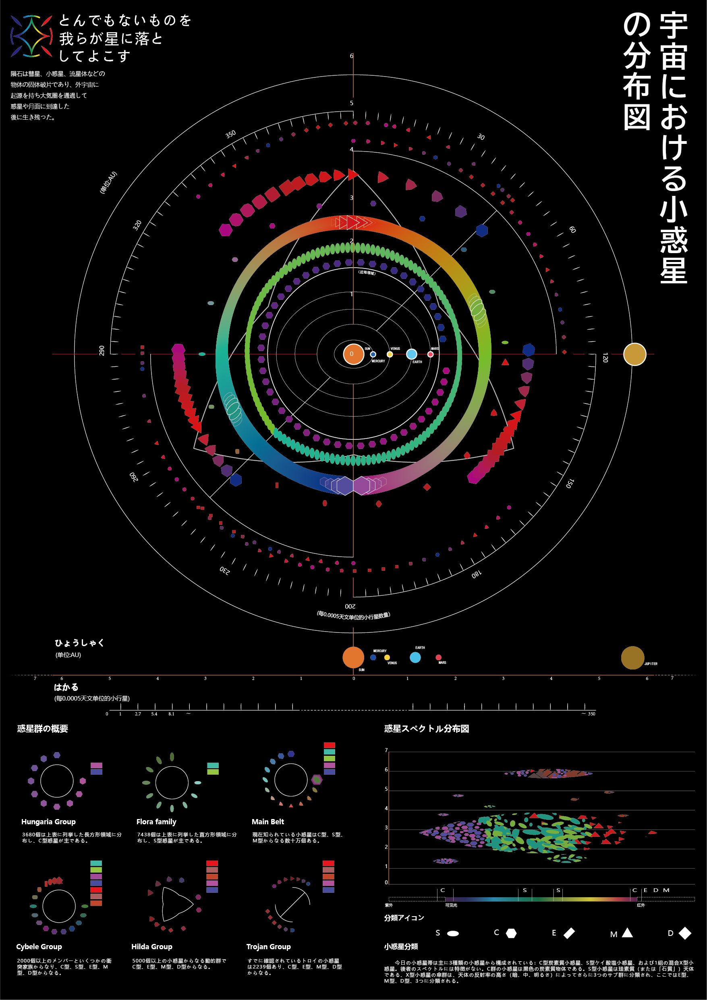
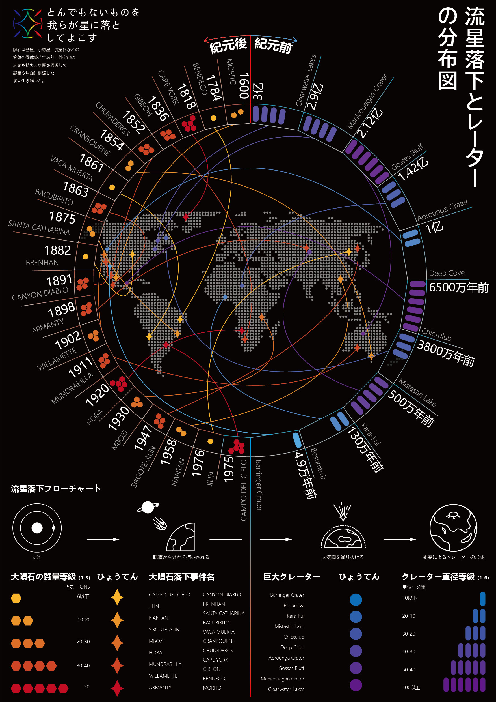
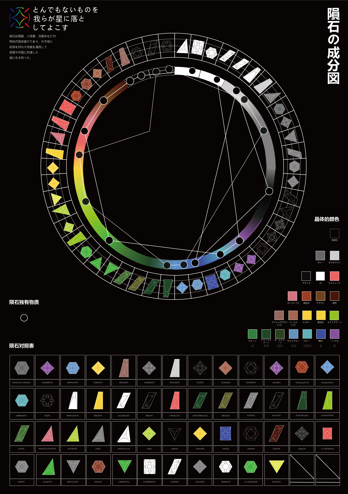

# NEW CELESTIAL ARCHIVE

### 新-天象图库

**以陨石为线索，连接宇宙轨道、地表记录与微观晶体的交互信息设计项目。**

信息可视化 · 交互叙事 · 三维视觉 · 数字档案

[在线探索](https://tianming332.github.io/TJM-NEW_CELESTIAL_ARCHIVE/) · [项目介绍](#项目介绍) · [设计版权](#设计版权) · [数据与致谢](#数据来源与致谢)

设计 / 天将明 Tian Jiangming

---

## 项目介绍

NEW CELESTIAL ARCHIVE「新-天象图库」围绕陨石建立了一套跨尺度的视觉档案。从太阳系中小天体的轨道与族群，到陨石抵达地球后留下的记录与撞击结构，再深入矿物组成和晶体形态，项目把天文学、地理与物质结构组织成一条可以连续探索的阅读路径。

项目以作者的原始信息图为视觉基础，将圆环、刻度、几何符号、分类色彩与图表关系转化为可操作的网页。观众可以切换视角、筛选对象、播放时间、拆分信息图层，或进入单个晶体观察与比较，在整体图景与具体样本之间建立联系。

## 三个观察尺度

| 尺度 | 关注的问题 | 线上体验 |
| --- | --- | --- |
| **01 / COSMIC · 宇宙** | 小天体在哪里，如何运行，又如何被分类？ | 在天象、轨道、族群、光谱与时间五种模式间切换，通过视角、图层和对象档案阅读空间关系。 |
| **02 / EARTH · 地球** | 陨石如何进入人类的地表记录？ | 在平面地图与球体投影之间观察分布，按记录状态、年份、质量和类别筛选，并分别阅读陨石记录与代表性撞击结构。 |
| **03 / MATERIAL · 物质** | 一块陨石内部的矿物与晶体如何被呈现？ | 通过样本、成分、光谱、晶系与对照模式，旋转观察八个原创晶体模型，比较形态、色相及透光、折射与色散的视觉变化。 |

三个尺度构成概念上的连续叙事，各自使用适合其主题的数据与表现方式：轨道用于理解空间，地图用于理解记录，晶体用于理解形态与材质。

## 设计表达

**从平面图表到可探索的空间。** 原始海报建立整体结构，网页将其中的空间、时间和分类关系逐层展开。图表中的圆环成为轨道、地理参照或矿物目录，静态符号获得可选择、可聚焦、可对照的阅读方式。

**统一的观测仪器语言。** 深色背景、白色细线、环形刻度、十字坐标与编号体系构成三个板块共同的视觉秩序；色彩与几何符号承担分类和识别功能，让密集信息保持层次。

**以交互组织信息层级。** 视角切换、筛选、图层与侧栏解读将复杂内容分次呈现，观众既能保持对整体的感知，也能进入单个对象查阅细节。中、英、日文界面与可调信息尺寸服务于不同的阅读需求。

**把材质观察纳入信息叙事。** 物质尺度使用作者制作的八个晶体网格，以实时光学视觉模拟呈现晶面、透明度、折射、色散与焦散，使形态与光线成为可以主动观察、调整和比较的内容。

### 原始信息图

以下为交互网站的平面设计基础；线上版本进一步展开对应的空间、时间与样本关系。

| 宇宙 / 轨道与分类 | 地球 / 分布与记录 | 物质 / 矿物与晶体 |
| :---: | :---: | :---: |
|  |  |  |

## 设计版权

**© 2026 天将明（Tian Jiangming）。保留所有权利。**

除明确标注的第三方内容外，本项目的原创视觉设计、交互设计、文字、图表编排、三维晶体模型，以及作者拍摄和制作的渲染资产，其权利归天将明（Tian Jiangming）所有。

本仓库与线上网站用于作品展示和项目介绍。未经作者书面许可，不得复制、再分发、修改上述原创内容或将其用于商业用途。项目的公开展示不构成对原创设计与资产的使用授权。

第三方开源软件的许可仅适用于相应软件，不延伸至本项目的原创视觉、交互、图表与模型；第三方数据、影像的权利仍归相应权利人，使用时须遵循各自的许可与署名要求。

## 数据来源与致谢

项目结合公开科学数据、作者的信息设计与实时视觉模拟。小天体资料参考 NASA/JPL，陨石记录采用 NASA Open Data 历史快照及 The Meteoritical Society 来源体系；大陆轮廓、代表性撞击结构与矿物光谱参考分别来自 Natural Earth、Earth Impact Database 与 USGS。深空背景影像按具体来源保留 NASA、ESA、CSA、STScI 等署名。

感谢 Vercel Labs 的 **vgpu**（MIT License）及相关示例，为物质尺度的 WebGPU 渲染与光学视觉研究提供支持；网页中的相关实现与视觉研究参考另见页面资料区及项目说明。

为准确理解作品：宇宙尺度使用本地精选数据与近似轨道推演；地球尺度呈现历史记录快照；物质尺度的透光率、折射率、色散与代表波长属于视觉模拟。三者分别服务于设计表达，不作为实时星历、完整事件统计或矿物学实测结果使用。

详细来源、数据口径与第三方许可见 [数据来源与致谢](DATA_SOURCES_AND_CREDITS.md) 和 [第三方声明](THIRD_PARTY_NOTICES.md)。
